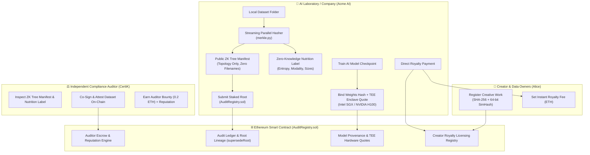

# ♧ Crypto-Audit: Trustless, Multi-Party Decentralized Web3 Protocol

> **Cryptographic Dataset Auditing, AI Model Provenance, and On-Chain Royalty Marketplace for Frontier AI & Enterprise Data.**

[](https://soliditylang.org/)
[](https://hardhat.org/)
[](https://python.org/)
[](https://flask.palletsprojects.com/)
[](https://web3py.readthedocs.io/)
[](https://pinata.cloud/)
[](https://github.com/Fungus12th/crypto-audit)

---

## 🌟 Executive Summary & Vision

Modern enterprises, healthcare consortia, and frontier AI laboratories face unprecedented regulatory, legal, and cryptographic challenges:

1. **EU AI Act & Data Provenance Compliance**: Regulators, courts, and copyright holders demand mathematical proof that training datasets, medical cohorts, and model weights have not been silently manipulated, poisoned, or scraped without authorization.
2. **Confidentiality vs. Public Auditability**: Raw proprietary datasets cannot be exposed on public blockchains, nor can private IPFS decentralized storage URLs be leaked.
3. **The "Hostage Tree" Vulnerability**: Traditional enterprise auditing forces users to ask the AI company's server to generate Merkle proofs. If the company goes offline or withholds proofs, verifiers are held hostage.
4. **Data Ownership & Fair Compensation**: Creators need a frictionless on-chain marketplace where original works are cryptographically fingerprinted and AI companies can pay instant micro-royalties on-chain.

**Crypto-Audit** solves these dilemmas by transforming dataset auditing into a **Trustless, Multi-Party Decentralized Web3 Protocol**.

---

## 🏛 Protocol Architecture



---

## ✨ Key Protocol Capabilities

### 1. Multi-Party Separation of Powers & Auditing
* **Submitter vs. Auditor Separation**: Dataset submitters (AI companies) are strictly prevented from self-attesting. Independent authorized auditors (Regulators / CertiK) must inspect datasets on-chain.
* **Auditor Service Bounty**: Dataset submissions deposit an auditor fee (e.g., `0.2 ETH`) into smart contract escrow. Upon on-chain attestation, the contract automatically transfers the fee to the auditor and increments their on-chain reputation score.

### 2. Zero-Knowledge Dataset Nutrition Labels
* Calculates empirical dataset health metrics without exposing confidential contents:
  * **Entropy**: Average Shannon entropy across all files.
  * **Modality Breakdown**: Percentage split of tabular (`CSV`), structured (`JSON`), text (`TXT`), genomics (`FASTA`), images, and binaries.
  * **Volume & Size Distribution**: File volume and granular bucket counts (`<10KB`, `10KB-1MB`, `>1MB`).
* Pinned to IPFS as **Public Zero-Knowledge Tree Manifests** containing hash topology only—**zero raw filenames or private paths**.

### 3. AI Model Checkpoint Provenance & TEE Hardware Attestation
* Links trained model weights (e.g., `PyTorch`, `Safetensors`, `ONNX`) directly to an audited dataset Merkle root.
* Anchors **Confidential Computing Hardware Quotes** (Intel SGX / NVIDIA H100 TEE) and **Canary Trap Hashes** directly on-chain, proving weights were generated strictly within a verified hardware enclave bound to the dataset.

### 4. Dataset Version Lineage & GDPR Purging (`supersedeRoot`)
* When poisoned data, PII, or copyrighted materials must be purged (e.g., GDPR "Right to be Forgotten"), companies submit a clean `v2` dataset and call `supersedeRoot()`.
* The parent root is revoked on-chain with a permanent public revocation reason and points to its cryptographic successor.
* The system automatically unpins and prunes the revoked dataset from off-chain IPFS storage.

### 5. Creator IP & Royalty Marketplace
* **Permissionless Work Registration**: Creators register original files by anchoring their exact SHA-256 hash and 64-bit fuzzy SimHash alongside their custom royalty price (e.g., `0.05 ETH`).
* **Automated Match Detection**: The system scans anchored Merkle trees and flags when a creator's work is included in an AI training set.
* **Frictionless Direct Royalties**: AI companies click **"Pay Royalty & License"** to transfer the exact royalty fee directly into the creator's wallet on Ethereum, permanently marking the dataset as `✓ Royalty Paid • Licensed`.

### 6. Client-Side Zero-Trust Web3 Verification
* Browser-native W3C WebCrypto API (`crypto.subtle.digest`) computes SHA-256 hashes locally.
* Verifies Merkle proofs independently of company servers. Files never leave the user's browser.

---

## 🎭 Multi-Actor Web3 Identity & Role Separation

The unified single login portal automatically maps authenticated credentials to role-locked Web3 accounts:

| Persona | Username / Password | Web3 Address | Role & Permissions | Starting ETH |
| :--- | :--- | :--- | :--- | :--- |
| **Acme AI Corp** | `acme` / `acme123` | `#1` `0x7099...79C8` | AI Lab / Dataset Submitter & Model Provenance | 10,000.0 ETH |
| **EU AI Regulator / CertiK** | `certik` / `certik123` | `#2` `0x3C44...93BC` | Independent Compliance Auditor (Attests Datasets & Earns Reputation) | 10,000.0 ETH |
| **Alice Nakamoto** | `alice` / `alice123` | `#3` `0x90F7...b906` | Independent Creator & Royalty Earner | 10,000.0 ETH |
| **Protocol DAO** | `admin` / `admin123` | `#0` `0xf39F...2266` | Protocol Deployer, Auditor Licenser & Circuit Breaker | 10,000.0 ETH |

### Strict Multi-Party Boundary Enforcement:
* **No Company Self-Attestation**: Dataset submitters cannot attest or approve their own datasets; an accredited independent auditor must inspect and co-sign.
* **No Auditor Model Hijacking**: Independent auditors cannot upload datasets or bind AI model checkpoints. Smart contracts enforce `require(records[recordId].submittedBy == msg.sender)` so only the authentic dataset creator can bind AI models.
* **Per-Match Direct Royalties**: When an AI company incorporates a creator's registered file, the royalty fee is settled directly per-dataset root on Ethereum. Stale or unanchored roots are strictly filtered out via `rootExists` validation.

---

## 📁 Repository Structure

```
crypto-audit/
├── contracts/
│   └── AuditRegistry.sol            # Multi-party EVM smart contract
├── scripts/
│   └── deploy.js                    # Contract deployment & auditor setup
├── test/
│   ├── AuditRegistry.test.js        # Hardhat core test suite
│   ├── AuditRegistryProtocol.test.js # Hardhat protocol & tokenomics test suite
│   └── test_backend_api.py          # Python integration test suite
├── python/
│   ├── merkle.py                    # Parallel streaming Merkle tree & SimHash
│   ├── ipfs_pinata.py               # Zero-Knowledge manifest pinning & auto-prune
│   ├── server.py                    # Flask Web3 backend & wallet coordinator
│   ├── audit.py                     # CLI for hashing, proving, and verifying
│   ├── submit_root.py               # CLI tool to submit Merkle root
│   └── read_blockchain.py           # CLI tool to inspect on-chain records
├── frontend/
│   ├── index.html                   # Unified single login portal
│   ├── company-home.html            # AI Lab dashboard & AI provenance ledger
│   ├── company-upload.html          # Dataset ingestion, ZK nutrition & anchoring
│   ├── user-home.html               # Verifier dashboard
│   ├── user-verify.html             # Client-side zero-trust file verification
│   ├── public.html                  # Public explorer & Royalty Marketplace
│   ├── css/style.css                # Forest & Sage palette with JetBrains Mono
│   └── js/app.js                    # Web3 frontend state & cryptographic engine
├── demo_datasets/                   # Sample multi-modal test datasets
│   ├── dataset_v1_medical/          # Initial 5-file medical dataset
│   ├── creator_alice_work/          # Alice's standalone research paper
│   ├── dataset_v2_sanitized/        # Clean v2 dataset for superseding purge
│   └── dataset_v3_unlicensed/       # Dataset with uncompensated training batch
├── hardhat.config.js                # Hardhat network & Solidity settings
├── requirements.txt                 # Python dependencies
└── package.json                     # Node.js dependencies & scripts
```

---

## 🚀 Quick Start Guide

### Prerequisites
* **Node.js**: v18.0.0 or higher
* **Python**: v3.8 or higher
* **npm** or **yarn**

### 1. Clone & Install Dependencies
```bash
git clone https://github.com/Fungus12th/crypto-audit.git
cd crypto-audit

# Install Node.js & Hardhat dependencies
npm install

# Install Python Web3 & cryptographic packages
pip install -r requirements.txt
```

### 2. Configure Environment (Optional for IPFS)
Copy the example environment file:
```bash
cp .env.example .env
```
*(Optional)* Add your free [Pinata IPFS](https://www.pinata.cloud/) JWT to `.env` for public IPFS pinning. If omitted, the system seamlessly runs in local hybrid storage mode.

### 3. Launch the Protocol

Open two terminal windows:

**Terminal 1 — Local Ethereum Node:**
```bash
npx hardhat node
```

**Terminal 2 — Deploy Contract & Start Web3 Server:**
```bash
# 1. Deploy the smart contract and authorize actors
npx hardhat run scripts/deploy.js --network localhost

# 2. Start the Web3 Flask application
python3 python/server.py
```

Visit **`http://127.0.0.1:5000`** in your browser!

---

## 🧪 Interactive Walkthrough & Demo

For an end-to-end interactive demo using the provided `demo_datasets/`:

1. **Log In as Acme AI (`acme` / `acme123`)**:
   * Navigate to **Upload Dataset**. Select all 5 files in `demo_datasets/dataset_v1_medical/`.
   * Inspect the **Zero-Knowledge Nutrition Label** generated in real time.
   * Click **Anchor Root On-Chain ↗** to deposit the 0.2 ETH auditor bounty and anchor the root.
2. **Bind AI Model Checkpoint**:
   * On `company-home.html`, click **Bind Model Checkpoint ⛓**.
   * Link `MedVision-Llama-70B` with model weights hash, metrics JSON, and Intel SGX TEE hardware quote hash.
3. **Attest Dataset as CertiK (`certik` / `certik123`)**:
   * Sign in as CertiK.
   * Under Active Datasets, click **`⚖️ Attest Dataset`**, enter your report URI, and confirm.
   * CertiK's wallet immediately receives the **0.2 ETH auditor fee**, and their on-chain reputation increments.
4. **Register Original Work as Alice (`alice` / `alice123`)**:
   * In the **🎨 Creator IP & Royalty Marketplace** tab, click **＋ Register Creator IP**.
   * Select `demo_datasets/creator_alice_work/alice_medical_paper.txt` and set a `0.391 ETH` royalty fee.
   * The system detects the match in Acme's training data: **`⚠️ Royalty Pending`**.
5. **Direct Royalty Settlement**:
   * Acme AI Corp clicks **`⚡ Pay Royalty & License (0.391 ETH)`**.
   * The royalty transfers on Ethereum directly into Alice's wallet, turning the dataset green: **`✓ Royalty Paid • Licensed`**.
6. **Supersede & Purge Poisoned Data**:
   * Acme uploads `demo_datasets/dataset_v2_sanitized/` and checks **☑ Supersede Earlier Dataset**.
   * Selects `v1` as the parent root with revocation reason.
   * The old root is marked `SUPERSEDED`, its off-chain IPFS storage is pruned, and `v2` becomes the canonical dataset.

---

## ⚡ CLI Tools Reference

Crypto-Audit includes Python CLI utilities for automated CI/CD pipelines:

```bash
# Hash any folder and compute streaming Merkle root
python3 python/audit.py hash-dataset ./data

# Generate a standalone cryptographic Merkle proof for a single file
python3 python/audit.py prove ./data/clinical_notes.txt --dataset ./data

# Verify a file against a known Merkle root
python3 python/audit.py verify ./data/clinical_notes.txt --dataset ./data --root <ROOT_HEX>

# Submit Merkle root directly to the blockchain from terminal
python3 python/submit_root.py --version v1.0 --creator "Acme Labs" --account 1

# Inspect on-chain audit ledger from terminal
python3 python/read_blockchain.py
```

---

## 🛡 Security & Smart Contract Verification

To run the complete smart contract test suite:
```bash
npx hardhat test
```

### Passing Tests (24/24):
* `✔ should store and retrieve an audit record`
* `✔ should emit RootSubmitted event with correct args`
* `✔ should reject submitRoot from unauthorized address`
* `✔ should enforce separation of powers: company submitter cannot self-attest`
* `✔ should allow independent auditor to attest dataset and receive service fee`
* `✔ should supersede an old root and track lineage immutably`
* `✔ should register an AI model checkpoint bound to an anchored dataset`
* `✔ should anchor TEE hardware enclave quote hash and canary trap hash for AI model`
* `✔ should register creator IP and allow direct automated licensing`
* `✔ should verify a valid Merkle proof matching python/merkle.py calculation directly on EVM`

---

## 📄 License

This project is licensed under the **MIT License** — see the [LICENSE](LICENSE) file for details.
